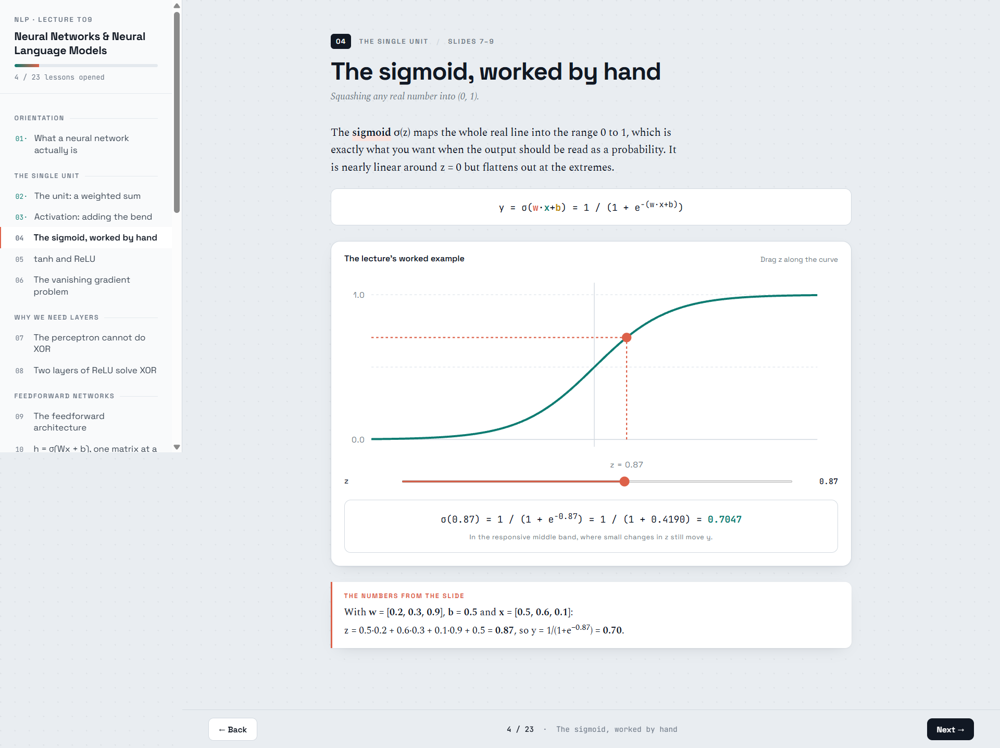
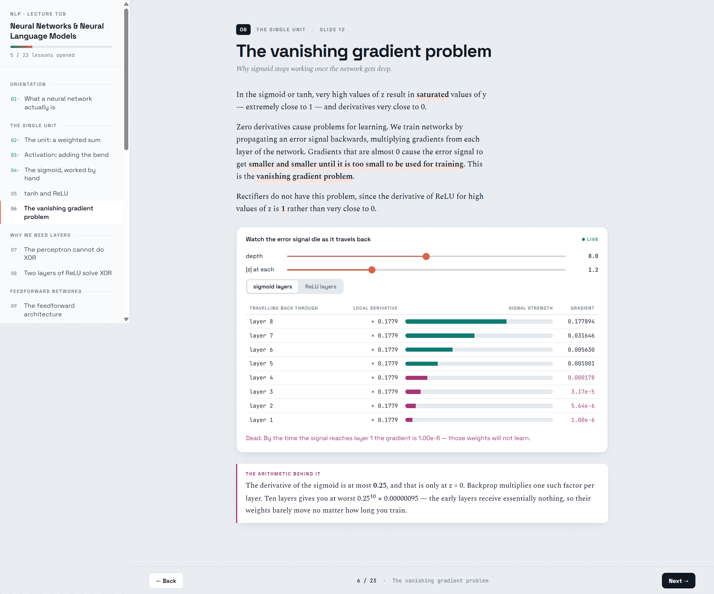
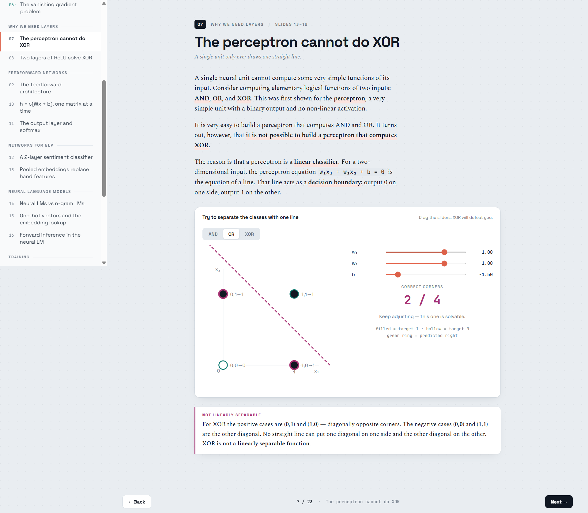
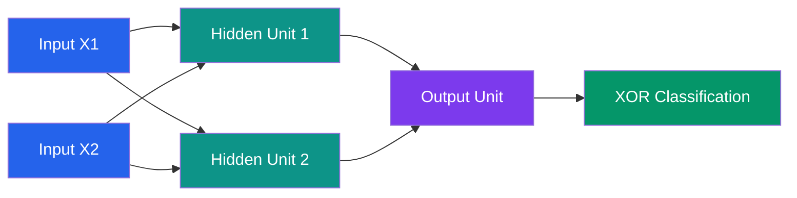
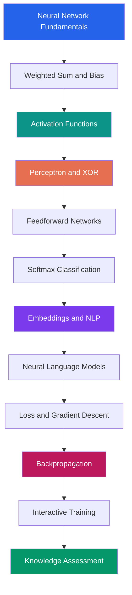
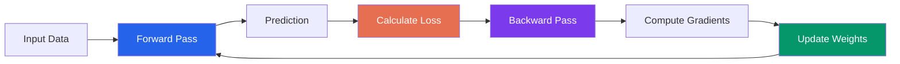
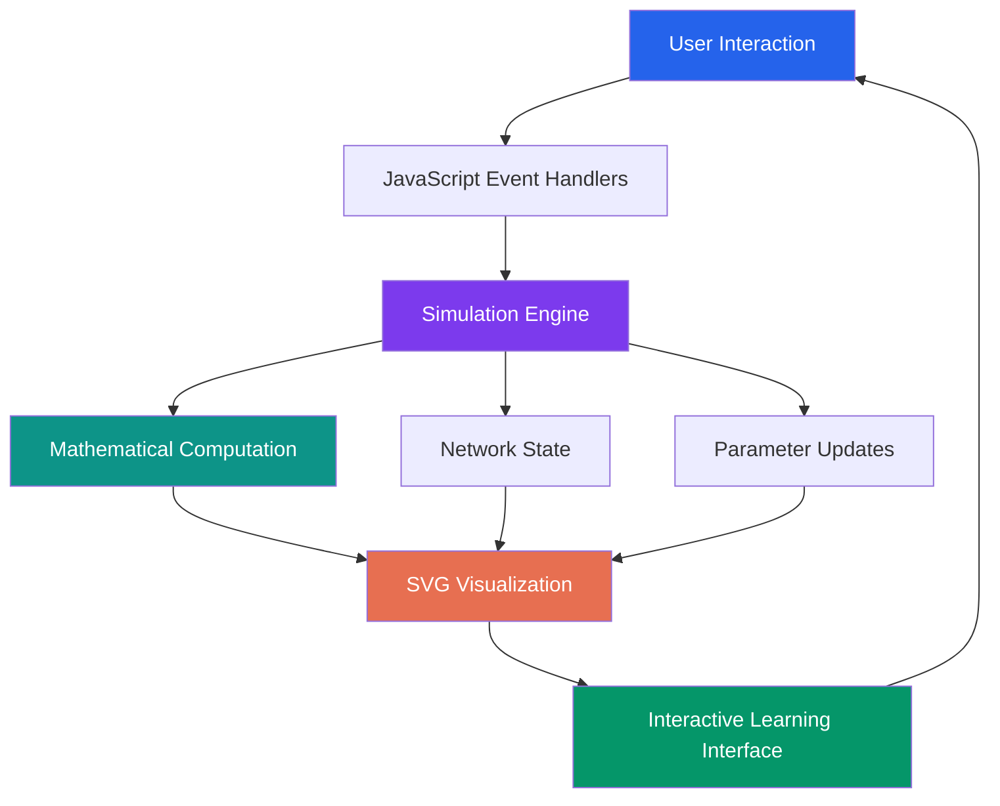

<div align="center">

# 🧠 Neural Network Lab

### Understand the Mathematics Behind Deep Learning

An interactive educational laboratory for Neural Networks, Deep Learning and Neural Language Models.


<br>

### [🚀 Launch Interactive Lab](https://arafat-rahman-lisan.github.io/neural-network-simulation/)

[Overview](#overview) • [Visual Showcase](#visual-showcase) • [Curriculum](#learning-curriculum) • [Architecture](#system-architecture)

<br>


*Don't just memorize neural networks. Understand how they work.*

</div>

---

## Overview

Neural Network Lab transforms theoretical deep learning and NLP concepts into interactive mathematical experiments.

Instead of relying exclusively on static lecture slides and equations, the platform allows learners to manipulate weights, biases, activation functions and network parameters while observing their effects in real time.

The project contains 23 structured lessons, progressing from a single computational neuron to feedforward neural networks, language models, gradient descent and backpropagation.

| 23 Lessons | 9 Learning Modules | 10 Review Questions |
|:---:|:---:|:---:|
| Interactive curriculum | Progressive mathematical concepts | Self-assessment |

---

## Visual Showcase

### 01 · Neural Network Signal Propagation

<div align="center">


</div>

Explore how information travels through input, hidden and output layers.

- Animated neural signal propagation
- Feedforward network representation
- Interactive network diagrams
- Conceptual explanation of hidden layers
- Comparison with logistic regression

---

### 02 · Activation Function Playground

<div align="center">



</div>

Experiment with activation functions and observe how numerical inputs are transformed into nonlinear outputs.

- Adjustable input values
- Real-time sigmoid calculations
- Interactive mathematical curves
- Step-by-step numerical substitution
- Sigmoid, tanh and ReLU comparisons

The fundamental computation:

$$
z = \mathbf{w}^{T}\mathbf{x}+b
$$

$$
\sigma(z)=\frac{1}{1+e^{-z}}
$$

---

### 03 · Vanishing Gradient Simulation

<div align="center">



</div>

Visualize how gradients become progressively smaller as they travel backward through a deep neural network.

| Interactive Parameter | Purpose |
|---|---|
| Network depth | Adjust the number of layers |
| Activation magnitude | Explore saturation effects |
| Activation type | Compare sigmoid and ReLU |
| Gradient strength | Observe signal decay layer by layer |

The simulation illustrates repeated multiplication of local derivatives in a simplified backpropagation scenario.

$$
g_{\text{early}} = g_{\text{late}}
\prod_{i=1}^{n} f'(z_i)
$$

When derivatives repeatedly take values much smaller than one, gradients can become extremely small.

---

### 04 · Perceptron and XOR Classification

<div align="center">



</div>

Investigate why a single perceptron can classify AND and OR but cannot represent XOR.

- Interactive AND, OR and XOR datasets
- Adjustable weights and bias
- Real-time decision boundary visualization
- Classification accuracy feedback
- Multilayer ReLU solution for XOR

| Input 1 | Input 2 | AND | OR | XOR |
|:---:|:---:|:---:|:---:|:---:|
| 0 | 0 | 0 | 0 | 0 |
| 0 | 1 | 0 | 1 | 1 |
| 1 | 0 | 0 | 1 | 1 |
| 1 | 1 | 1 | 1 | 0 |

A single linear decision boundary cannot separate XOR's positive and negative classes.



---

## Learning Curriculum

The learning experience is divided into nine progressive modules.

| Module | Topics | Lessons |
|---|---|:---:|
| Orientation | Neural network fundamentals | 01 |
| The Single Unit | Weighted sum, activation functions, vanishing gradients | 02–06 |
| Why We Need Layers | Perceptron limitations and XOR | 07–08 |
| Feedforward Networks | Network architecture, matrix operations, softmax | 09–11 |
| Networks for NLP | Sentiment classification and pooled embeddings | 12–13 |
| Neural Language Models | N-grams, one-hot encoding, embedding lookup, inference | 14–16 |
| Training | Loss functions and gradient descent | 17 |
| Backpropagation | Forward pass, chain rule, weight updates and training | 18–22 |
| Review | Ten conceptual self-assessment questions | 23 |

---

## Learning Roadmap



---

## Neural Language Model Simulation

The platform extends neural network fundamentals into Natural Language Processing.


Key concepts:

- One-hot vector representation
- Embedding matrix lookup
- Neural versus n-gram language models
- Hidden layer computation
- Probability distribution generation
- Next-word prediction
- Sentiment classification using pooled embeddings

---

## Training and Backpropagation

The training modules demonstrate how neural networks update their parameters through gradient-based optimization.



The weight update rule:

$$
w_{\text{new}} =
w_{\text{old}}-\eta\frac{\partial L}{\partial w}
$$

Interactive implementations include:

- Forward propagation with numerical examples
- Loss calculation
- Gradient descent visualization
- Chain-rule decomposition
- Output and hidden layer weight updates
- Interactive training loop
- Training loss visualization

---

## Engineering Highlights

### Real-Time Mathematical Simulation

Neural network computations are implemented directly in JavaScript, allowing users to modify parameters and observe mathematical results immediately.

### Dynamic SVG Visualization

Network diagrams, activation curves, decision boundaries and training charts are generated using SVG.

### Lightweight Architecture

The entire application is implemented using a single HTML file containing the interface, styling, lesson content and simulation logic.

No JavaScript framework, backend server or machine learning library is required.

### Structured Learning Experience

- Categorized lesson navigation
- Session-based lesson progress tracking
- Interactive controls
- Mathematical equations
- Worked numerical examples
- Lecture slide references
- Answer-reveal review questions

---

## System Architecture



---

## Technology Stack

| Technology | Purpose |
|---|---|
| JavaScript | Mathematical computations and interactive simulations |
| HTML5 | Lesson structure and interface |
| CSS3 | Responsive layouts and visual styling |
| SVG | Dynamic charts and neural network diagrams |
| DOM Manipulation | Real-time interface updates |
| Google Fonts | Interface typography |
| GitHub Pages | Static website deployment |

---

## Running Locally

Clone the repository:

```bash
git clone https://github.com/arafat-rahman-lisan/neural-network-simulation.git
```

Navigate to the project directory:

```bash
cd neural-network-simulation
```

Open `index.html` in your browser.

Alternatively, start a local development server:

```bash
python -m http.server 8000
```

Visit:

```text
http://localhost:8000
```

No additional package installation or API credentials are required.

---

## Project Structure

```text
neural-network-simulation/
│
├── index.html
│
├── screencapture-arafat-rahman-lisan-github-io-neural-network-simulation-2026-11-25-01_36_14.png
├── screencapture-arafat-rahman-lisan-github-io-neural-network-simulation-2026-11-25-01_37_07.png
├── screencapture-arafat-rahman-lisan-github-io-neural-network-simulation-2026-11-25-01_37_19.png
├── screencapture-arafat-rahman-lisan-github-io-neural-network-simulation-2026-11-25-01_37_34.png
│
└── README.md
```

---

## Future Development

- Interactive CNN visualizations
- Recurrent neural network simulations
- Transformer and self-attention playground
- Interactive multi-head attention
- Persistent learning progress
- Custom dataset experimentation
- Additional mathematical exercises

These are proposed extensions to the existing platform.

---

## Developer

**Arafat Rahman**

Computer Science & Engineering

Interests: Artificial Intelligence, Machine Learning, Natural Language Processing and Interactive Learning Systems.

[GitHub Profile](https://github.com/arafat-rahman-lisan)

---

<div align="center">

## 🧠 Neural Network Lab

### Learn. Experiment. Visualize. Understand.

[Explore the Live Platform](https://arafat-rahman-lisan.github.io/neural-network-simulation/)

*Making the mathematics behind intelligent systems more accessible.*

If this project helps you understand neural networks, consider giving the repository a ⭐

</div>
